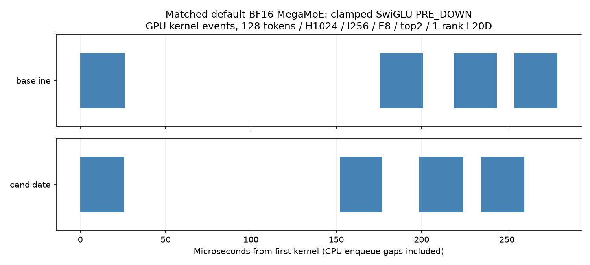

# DSV4.1 BF16 MegaMoE numerical boundaries

The optional FP32 output retains the fixed-top-k routed accumulator so the
caller can add its shared expert before the final BF16 conversion. Existing
BF16 callers retain the same compile-time BF16 store specialization.
FP32 output is rejected for other combine orders. No Python forward default,
FP8/FP4 forward implementation, or inference dependency pin changes.

Finite-clamped BF16 SwiGLU backward now follows the native FP32 activation,
route multiplication and SiLU VJP boundaries before BF16 stores. PRE_DOWN
phase-ordered callers must provide **disjoint** `h_act_output` and
`h_weighted_output`; the former retains the route-gradient activation and
the latter the once-rounded W2 input. Other alias contracts stay unchanged.

With `reverse_dispatch_prepared=True`, the backward consumes the PRE_DOWN
grad-y, x and route-weight pools that an earlier synchronized input prelude
filled on the same stream, and skips the grad-y expose copy and reverse pull.
The route-gradient plane is still cleared and both rank barriers still run
before direct grad-x writes. The flag requires `x_prepared`, `phase_ordered`
memory and PRE_DOWN routing and is rejected before any source mutation.

## Validation

Local NVIDIA L20D (SM103), CUDA 13, PyTorch 2.14.0+cu130, against
`2318c6958ce5c9f52393a0821274bc5f69fe33f8`:

- 32 tests passed: `tests/test_bf16_mega_moe_dsv41.py`,
  `tests/test_mega_moe_compat.py` and `tests/test_prepared_reverse_dispatch.py`.
- Twelve deterministic BF16 outputs (`fast_math` OFF/ON) are bitwise equal to the unmodified baseline:
  pre/post-down routing crossed with unclamped/clamped SwiGLU and clamped GeGLU.
  Shape: 128 tokens, H1024, I256, 8 experts, top2, one rank.
- Twelve optional FP32 outputs round exactly to their BF16 counterparts; default
  BF16 graph capture/replay passes. Inference wrappers introduce no host
  synchronized config collective (existing compatibility tests).
- Captured strict-math default-forward GPU medians span 26.7–27.2 us on both builds.
  With default fast math ON, medians span 24.9–26.8 us.
  CPU enqueue medians are 15–23 us; one initial 140 us outlier did not repeat
  in reversed-order measurements.

The timeline shows actual profiler kernel events, with CPU enqueue gaps
included.

Full pretrained DSV4.1 training (40 layers, 262144 tokens, CP4/EP4, all-40
input offload, same four GPUs, measured in the FireTitan integration): native
MoE F+B 13.947 s, MegaMoE 12.901 s, with bitwise-identical logprobs for all
262144 tokens on all four ranks.
