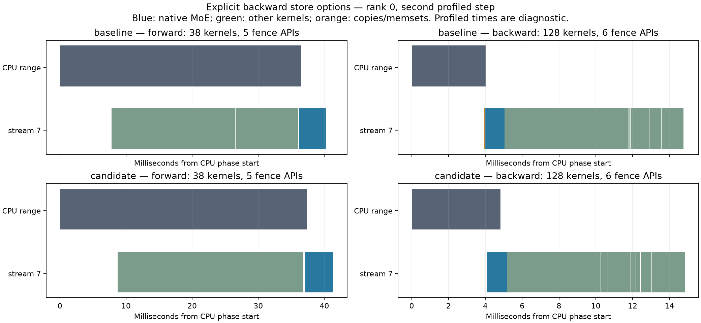

# Explicit BF16 backward options: validation

The BF16 merged-expert backward API accepts four keyword-only options: `split_barrier_fused_route=True`, `route_prelude_threads=128`, `vectorized_grad_x_store=True`, and `wide_grad_x_store=False`. Defaults retain the existing route schedule and stores. The corresponding legacy environment variables are ignored by this path. H2048 honors the 128/256-thread route override; other hidden widths retain 256 threads.

**Rebuild the native extension.** The Python wrapper now passes the two store policies through pybind/C++ to the native launch. An old compiled extension is incompatible with the updated wrapper. Existing positional Python calls remain valid; native parameters have defaults. The separate side-LoRA kernel still has its own store environment reads and is outside this change.

## Numerical and compatibility evidence

- 24 CPU tests pass: defaults against conflicting environment values, route schedules, H2048/H3584, 128/256 threads, invalid arguments before native calls, changing store policies within one process, and the existing compatibility suite.
- 224 candidate records plus 56 DeepEP reference records pass across seven changing physical-length cases and all four store combinations, fixed capacity 1024. Minimum candidate cosine is 0.9999966743992496, strictly above 0.99999. Output, input/score gradients and all six factor gradients use the same quantization/rounding policy; zero references require exact equality. Repeated forwards match bitwise.
- Every store variant is warmed before length changes. Cache contents remain unchanged and no external compiler execution occurs after warmup. The numerical capture overlapped diagnostics and is used only for correctness/compiler evidence.
- The earlier route-option change separately passed 96 EP8 logical-case records (minimum cosine 0.9999966590411484). Alternate route schedules and the H2048 override have CPU launch-order coverage; the production GPU measurements use the default schedule at H3584.

## Matched default timing

8x B300, EP8, H3584/I3072/E896/top16, shared LoRA128, native MXFP4 frozen storage with BF16 expert arithmetic, 4096 tokens/rank. Forward includes exact LoRA merging; backward includes factor gradients and shared reductions. Four fresh-process ABBA blocks, 10 warmups and 30 slowest-rank samples per phase per block; medians pool 60 samples per variant. All four whole-run process monitors are clean.

| Phase | Before ms | After ms | Change |
|---|---:|---:|---:|
| forward | 32.490383 | 32.533873 | +0.134% |
| backward | 11.504976 | 11.525216 | +0.176% |
| combined | 43.323521 | 43.313295 | -0.024% |

This refactor makes no speedup claim and the quartet does not establish a statistical non-inferiority bound.

## Separately instrumented memory

Two clean fresh-process runs, two warmups and three samples/phase. Timings from these runs are excluded. Each peak is the maximum across ranks and samples.

| Phase | Allocated GiB before / after | Reserved GiB before / after | Traced owned CUDA GiB before / after | Host RSS GiB before / after | CUDA pins MiB before / after |
|---|---:|---:|---:|---:|---:|
| forward | 11.445577 / 11.445577 | 26.283203 / 26.283203 | 31.664186 / 31.664186 | 4.050579 / 4.050522 | 1.125015 / 1.125015 |
| backward | 11.997194 / 11.997194 | 26.283203 / 26.283203 | 31.664186 / 31.664186 | 4.050579 / 4.050522 | 1.125015 / 1.125015 |
| combined | 11.997194 / 11.997194 | 26.283203 / 26.283203 | 31.664186 / 31.664186 | 4.050579 / 4.050522 | 1.125015 / 1.125015 |

GPU allocated/reserved/owned-CUDA and CUDA-pinned peaks are unchanged. Host RSS is a process-lifetime maximum, including setup. Driver-private residency and non-CUDA/RDMA pins are excluded. This 4K operator result does not establish all-length/full-model memory acceptance.

## CPU, launch and fence audit

Matched clean traces cover three combined iterations on all eight ranks. Across all 48 matched rank/step/phase records, kernel-name multisets, copy counts, launch counts and synchronization/wait API counts match exactly. Forward has 38 kernels/5 fence APIs; backward has 128 kernels/6 fence APIs. Device events are attributed through CUDA correlations across all CPU threads, including autograd workers.

Median profiled CPU ranges: forward 38.937 to 38.351 ms; backward 4.463 to 4.214 ms. Profiler startup creates large first-iteration outliers; these durations are diagnostic and are excluded from accepted timing. Code review finds one route-thread membership check and passing two scalar store arguments; no new GPU allocation, kernel launch or synchronization is introduced.



## Reproduction and provenance

After rebuilding/installing this checkout, run outside the source tree to avoid shadowing the installed extension:

```bash
CUDA_VISIBLE_DEVICES='' python -m pytest -q --import-mode=importlib \
  /path/to/DeepGEMM/tests/test_mega_moe_backward_options.py \
  /path/to/DeepGEMM/tests/test_mega_moe_compat.py
```

The GPU harness and raw evidence are retained on b300-devhost-5 under `/home/yued/.codex/worktrees/kimi-k31-moe-study/fireworks/`. The trainer is pinned to `aa0cd94de7ecea5c07b121a5f94f74967825177e`, torchtitan to `c2df5d84ff589357c03e5a63506d2dd950efc591`. Parent native package is `a4656659`; candidate source is `19e2d034`. Both include the separately reviewed expert-prefix correction from https://github.com/fw-ai-external/DeepGEMM/pull/35; this does not qualify the base without that dependency. Candidate native files are byte-identical to the GPU-tested snapshot, and the formatted production Python wrapper has the identical AST.

Run these CPU collectors from that study checkout to verify all raw records, file pins, exclusions, comparisons and plots:

```bash
/data/yued/moe-study/venv-report/bin/python docs/studies/kimi-k31-moe-ep8/collect_explicit_store_qualification.py
/data/yued/moe-study/venv-report/bin/python docs/studies/kimi-k31-moe-ep8/collect_explicit_store_memory.py
/data/yued/moe-study/venv-report/bin/python docs/studies/kimi-k31-moe-ep8/collect_explicit_store_timing.py
/data/yued/moe-study/venv-report/bin/python docs/studies/kimi-k31-moe-ep8/collect_explicit_store_trace.py
```

Exact GPU commands are recorded per monitor in the following profile roots; each `harness/` and `analysis/` retains the launcher/entry and source/package SHA256 pins. Choose a new output directory when repeating a command. The production harness is study-local; exporting its complete portable bundle remains part of the broader study.

- `profile/explicit-store-options-ep8-01` — 280-record numerical and compiler audit.
- `profile/explicit-store-options-memory-ep8-02` — default memory comparison.
- `profile/explicit-store-options-timing-ep8-01` — default ABBA timing.
- `profile/explicit-store-options-trace-ep8-01` — baseline attempt 2 and candidate attempt 3 accepted; earlier overlaps excluded.

The wider Kimi LoRA phase targets, CP/checkpoint/offload trainer integration, all-length memory and side-LoRA environment cleanup remain separate work.

Collected evidence checksums:

| Artifact | SHA256 |
|---|---|
| explicit-store-qualification.json | `879afac46621cfb53a7c5dc7e8032518e1d5a21ff03436dc4ae51ad1361a96eb` |
| explicit-store-memory.json | `a9a3d4b7cfc729c26d462a2710fdf4dde0a42a1de9a70e9576e4ba2d4afab503` |
| explicit-store-timing.json | `16ae4f2704e2d8c9f19e3b1d4961d438da0a2f02a40f64706e9c4a8e6a0e5861` |
| explicit-store-trace.json | `908bccdc8ca212259ebfcc64fab1ef0b5d4ff16e37a9850561d6a42cbd8e661d` |
